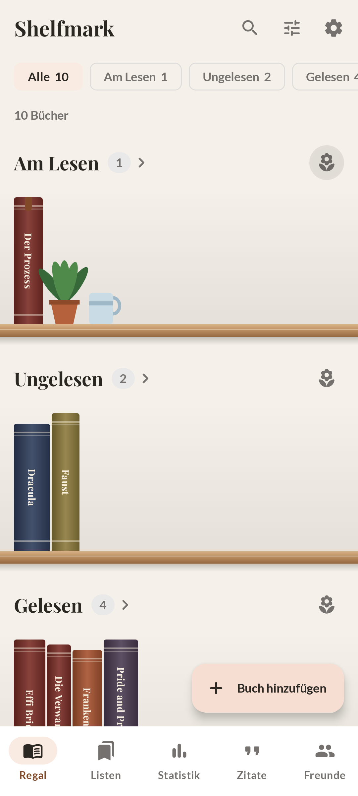
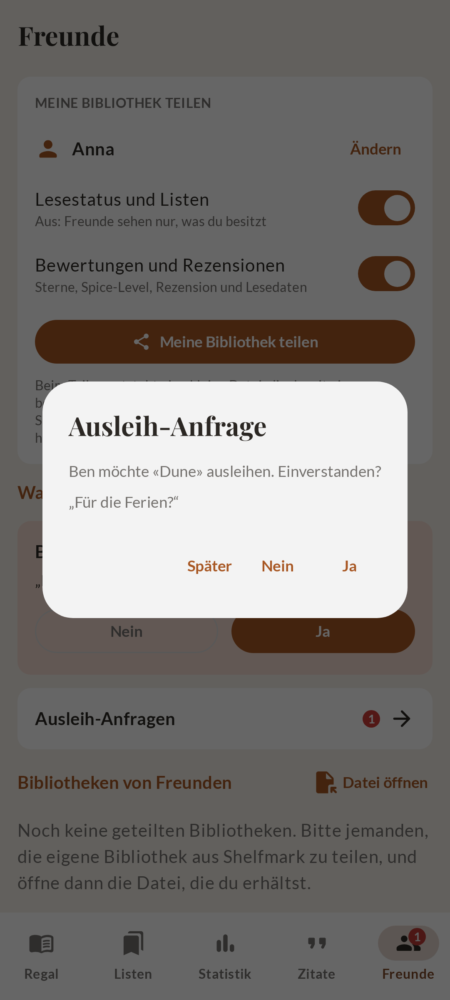
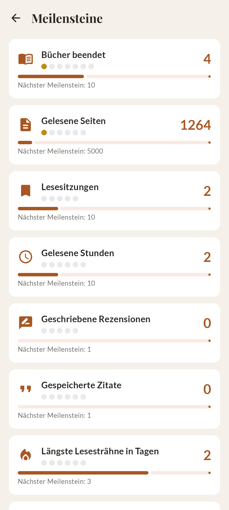

# Shelfmark

A personal library and reading tracker for Android. No account, no ads, no server: your books
stay on your phone. The interface is available in English and German.

This is the native Android version (Kotlin, Jetpack Compose) of the desktop Shelfmark. It can
import the desktop app's library file.

<p>
  
  
  
  
</p>
<p>
  
  
  
  
</p>

## What it does

**Adding books**

- Scan the ISBN barcode on the back of a book with the camera, several books in a row if you like.
- Search by title, author or ISBN. Suggestions appear while you type, which is what you want
  for old editions that have no barcode.
- Seven catalogues are asked at once (see [Book data](#book-data)), so a book missing from one
  is usually found in another.
- Enter a book completely by hand when no catalogue knows it.
- Per book: title, author, pages, format (hardcover, paperback, e-book, audiobook), blurb,
  publisher, year, language, series, genres, tags and a cover.
- Covers: a book that arrives without one gets a search in the background. **Search cover
  online** on the edit page shows every cover the catalogues have for you to pick from, or
  photograph it yourself.
- Import your list from Goodreads, StoryGraph or any CSV file (Settings > Import from other
  apps). Books you already have are not duplicated, they only gain what was missing.

**Organising**

- Built-in lists: Wishlist, Unread, Reading, Read, Abandoned. Moving a book between them keeps
  the start and finish dates up to date.
- As many lists of your own as you like.
- The shelf as book spines on wooden boards, as covers, or as a plain list. Books without a
  cover picture get a drawn cloth cover, so every book looks like a book.
- Ornaments: put a plant, a mug, a globe or nine other things between the books of any shelf.
- A purchase log per book: price, shop and date. The recaps add it up.

**Reading**

- Star rating in half steps, a spice level from one to five chillies, a review with the dates
  you started and finished.
- Reading sessions with progress and an estimate of the time left. A timer is there for
  those who want one, on the Reading tab of a book.
- Quotes: photograph the page (text recognition runs on the phone), paste from the clipboard,
  or share selected text from an e-book reader straight into Shelfmark.
- Notes, goals (books, pages or minutes, once or repeating), statistics and reading streaks.
- A calendar with the covers of what you read each day and a heatmap of the year.
- Recaps of every month and year: what you finished, your best day, favourite authors,
  when you read most, what you spent.
- Milestones for books, pages, sessions, hours, reviews, quotes, streaks and long books.

**Looks**

- 18 themes in light and dark, or build your own from four colours.

**Friends**

- Share your library as a small file through any messenger. You choose whether friends see
  only what you own, or also your reading status, lists, ratings and reviews.
- Per book: whether you own it, borrowed it, or do not have it, and whether friends may ask
  for it.
- A friend can ask to borrow a book that is available. You answer with one tap, yes or no.
  Saying yes marks your copy as lent to them.

## How sharing works

There is no server. Everything friends exchange is a small `.shelfmark.json` file that travels
through the messenger you already use:

1. You tap **Share my library** and send the file.
2. Your friend opens it with Shelfmark and can browse your shelf.
3. On a book that is available they tap **Ask to borrow**, which creates a request file to send
   back to you.
4. You open it, tap **Yes** or **No**, and send the answer file.

Share again whenever your shelf has changed. The friend's copy is replaced.

## Install

Take an APK from the [releases page](https://github.com/TRGamer-tech/shelfmark/releases), copy
it to the phone and open it. Android asks once whether it may install apps from that source.
For now a release has one file, the debug build `Shelfmark-x.y.z-debug.apk`.

**Updating.** Install the new APK over the old one, your library stays. That works between
all builds from the releases page, because they are signed with the same key,
and because the database is migrated step by step (the schemas of every version are kept in
`app/schemas`). The one thing Android refuses is going back to an older version.

If the older Shelfmark (the one built from the desktop version) is installed, export your
library there first, uninstall it, then install this one and import the export under
**Settings > Backup > Restore or import**. The two cannot be installed over each other unless
they are signed with the same key.

## Build

You need a JDK (17 or newer) and the Android SDK (platform 37.2, build-tools 37).

```sh
./gradlew assembleDebug        # app/build/outputs/apk/debug/app-debug.apk
./gradlew assembleRelease      # app/build/outputs/apk/release/app-release.apk
```

**Signing.** Android only installs an update over an earlier version that was signed with the
same key, so debug and release builds both use one stable key when it is available. Put a
`keystore.properties` next to `settings.gradle.kts`:

```properties
storeFile=/path/to/your.keystore
storePassword=...
keyAlias=...
keyPassword=...
```

or set `SHELFMARK_KEYSTORE_FILE` and `SHELFMARK_KEYSTORE_PASSWORD` in the environment. Without
either, both builds are signed with the debug key of your machine: they work, but only update
each other. Keep the keystore and the properties file private. They are listed in `.gitignore`.

**Releases.** Raise `versionName` and `versionCode` in `app/build.gradle.kts`, then start the
release workflow: **Actions > Release > Run workflow** on `main`. It builds the debug APK,
creates the tag `v<versionName>` and publishes a GitHub release with the APK attached. Pushing such a
tag yourself starts it too. The signing key comes from two repository secrets (Settings >
Secrets and variables > Actions): `SHELFMARK_KEYSTORE_BASE64` (the keystore file, base64
encoded) and `SHELFMARK_KEYSTORE_PASSWORD`. Without them the workflow stops before building.
Notes for a release go into `docs/releases/<tag>.md`.

**Changing the database.** Raise the version in `AppDatabase` and add a migration (an
`AutoMigration` is enough for new tables and columns). `MigrationTest` opens a database of the
first version with the current code and has to keep passing.

## Tests

```sh
./gradlew testDebugUnitTest
```

The suite covers the catalogue clients (against recorded responses), barcode decoding, the
sharing and borrow request flow between simulated phones, backup and import (Goodreads,
StoryGraph, CSV, the desktop Shelfmark), the database migration, statistics, calendar, recaps,
milestones and goals. It also drives the real screens (in German) and writes screenshots to
`app/build/outputs/roborazzi`.

- `SHELFMARK_LIVE=1 ./gradlew testDebugUnitTest --tests '*LiveCatalogueTest'` talks to the real
  catalogues.
- Maven Central rate-limits the large Robolectric jars per IP address. If the download is
  refused, point that one test dependency at a mirror:
  `-Pshelfmark.robolectricMirror=https://maven-central.storage-download.googleapis.com/maven2/`

## Book data

Every search and every scan asks all of these at once and merges the answers. None of them
needs an account.

| Catalogue | Good for |
| --- | --- |
| [Open Library](https://openlibrary.org) | The widest general catalogue, with covers and blurbs |
| Google Books | Blurbs and covers. It often refuses requests without a key, a free API key of your own can be entered under **Settings > Book catalogues** |
| Apple Books | Recent titles with large covers |
| [lobid](https://lobid.org) (hbz) | German-language books, quick suggestions while typing |
| [Deutsche Nationalbibliothek](https://www.dnb.de) | Everything published in Germany since 1913, and covers by ISBN |
| [K10plus](https://www.bszgbv.de/services/k10plus/) | The union catalogue of German academic libraries, old and rare editions |
| [swisscovery](https://swisscovery.slsp.ch) | Swiss libraries, Swiss publishers |

Cover pictures also come from the Open Library and DNB cover services, which answer by ISBN.

## Not here yet

Things the desktop Shelfmark has that this version does not: books lying in stacks, a sort
order per shelf, and the timer alarm.

A server for friends, so that libraries and borrow requests travel by themselves instead of as
files, is the next larger step.

## Licences

Code: MIT, see [LICENSE](LICENSE). Fonts: Playfair Display and Lato under the SIL Open Font
License, see [licenses](licenses). Text recognition uses Google ML Kit, which is free to use but
not open source.
