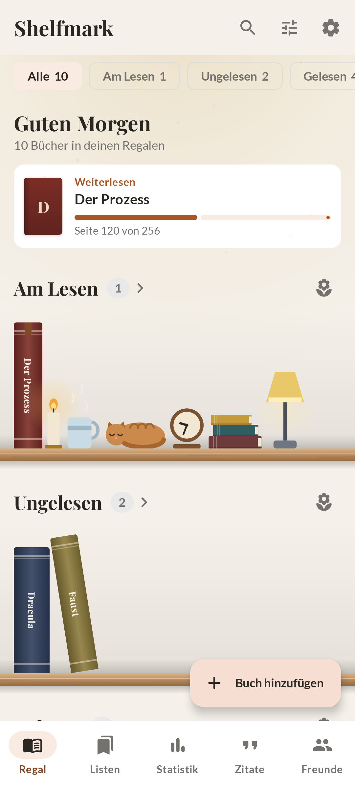
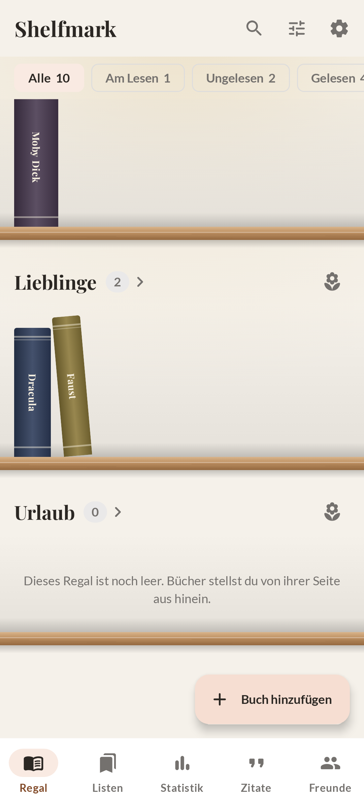
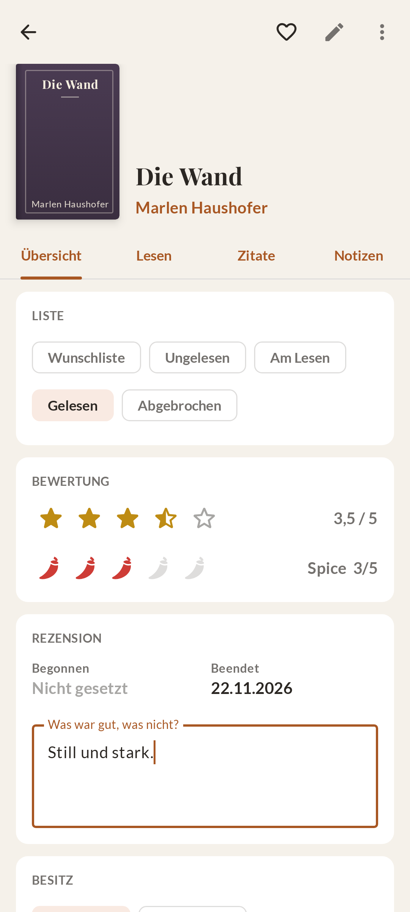
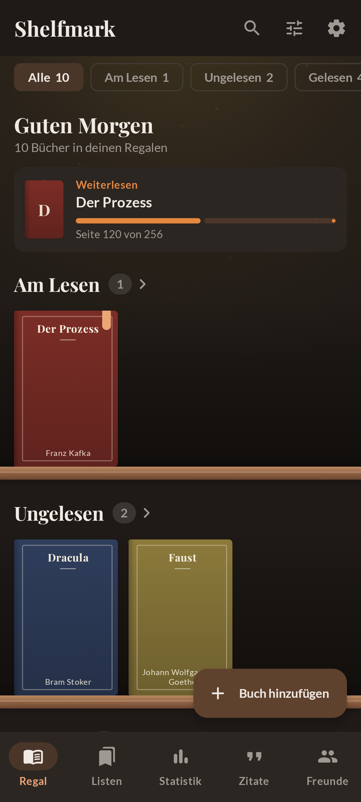
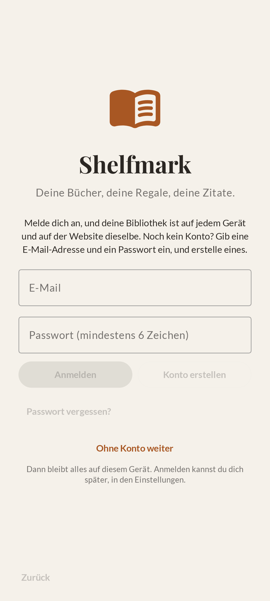
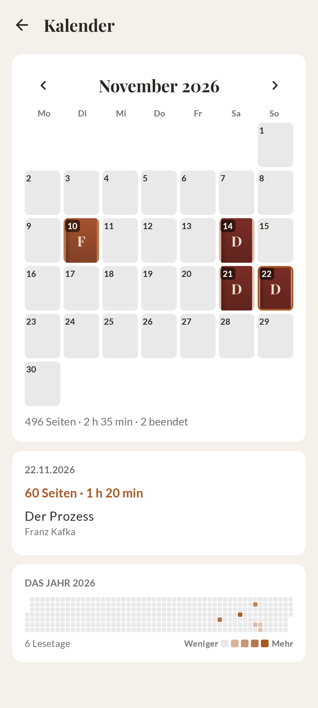
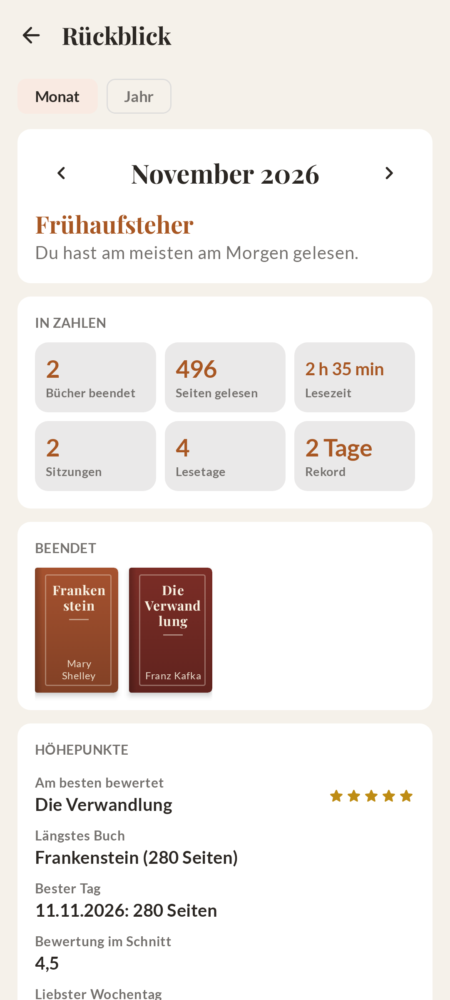
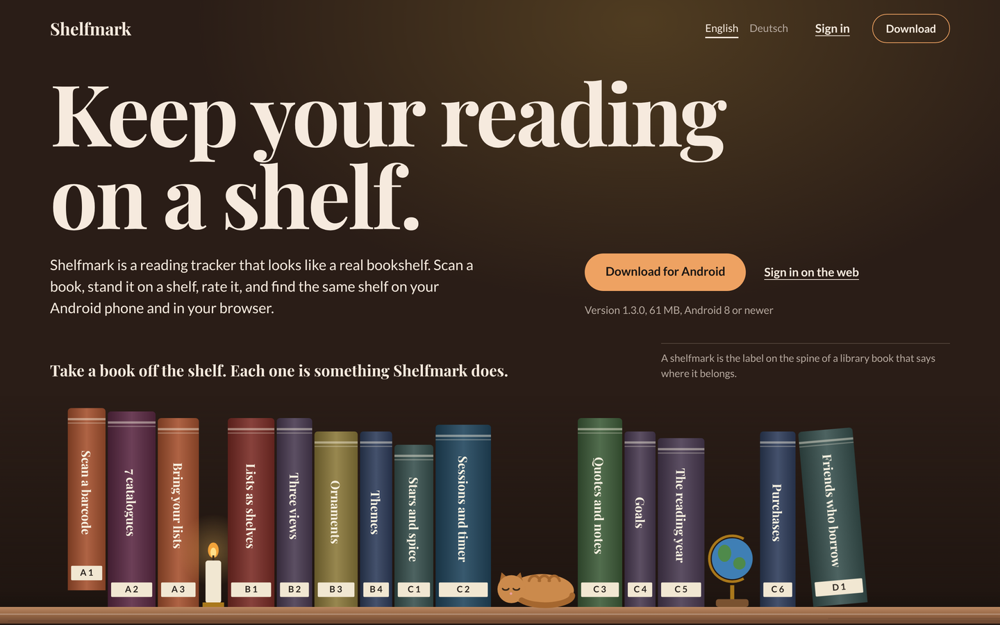
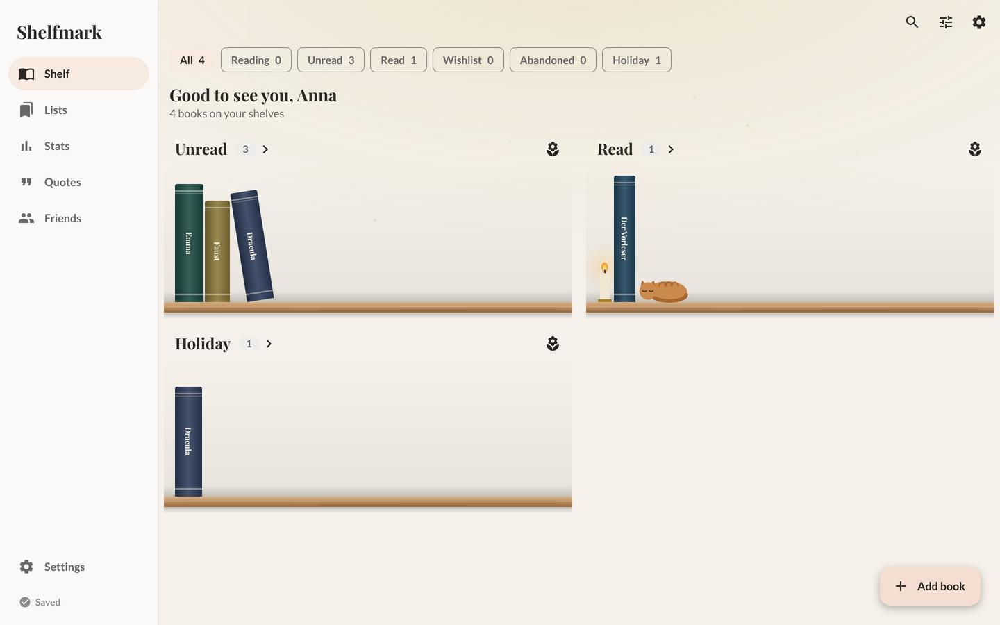
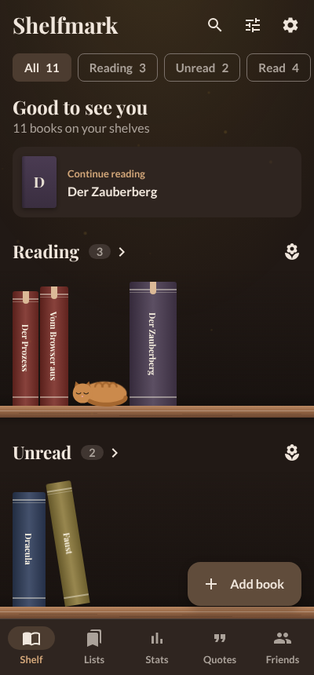

# Shelfmark

A personal library and reading tracker that tries to feel like a real bookshelf: an Android
app, and a website that shows the same shelf in a browser. No ads. The app asks you to sign
in when it is first opened, because one account is what puts the same shelf on every device.
It also works without one: then your books simply stay on your phone. The interface is
available in English and German.

- `app/`: the Android app (Kotlin, Jetpack Compose). It can import the library file of the
  older desktop Shelfmark.
- `web/`: the website (Next.js), for hosting on Vercel.
- `supabase/`: the server both of them talk to, a Supabase project.

<p>
  
  
  
  
</p>
<p>
  
  
  
  
</p>

## What it does

**Adding books**

- Scan the ISBN barcode on the back of a book with the camera, several books in a row if you like.
- Search by title, author or ISBN. Suggestions appear while you type, which is what you want
  for old editions that have no barcode.
- Seven catalogues are asked at once (see [Book data](#book-data)), so a book missing from one
  is usually found in another.
- Enter a book completely by hand when no catalogue knows it.
- Per book: title, author, pages, format (hardcover, paperback, e-book, audiobook), blurb,
  publisher, year, language, series, genres, tags and a cover.
- Covers: a book that arrives without one gets a search in the background. **Search cover
  online** on the edit page shows every cover the catalogues have for you to pick from, or
  photograph it yourself.
- Import your list from Goodreads, StoryGraph or any CSV file (Settings > Import from other
  apps). Books you already have are not duplicated, they only gain what was missing.

**The shelf**

- Built-in lists: Wishlist, Unread, Reading, Read, Abandoned. Moving a book between them keeps
  the start and finish dates up to date.
- As many lists of your own as you like. Each one is a shelf of its own below the built-in
  ones, also while it is still empty.
- Book spines on wooden boards, covers, or a plain list. Books without a cover picture get a
  drawn cloth cover, so every book looks like a book.
- It lives a little: lamplight falls on the shelf and dust drifts in it, books settle into
  place and rise under your finger, and the last book of a shelf that is not full leans on its
  neighbour.
- Ornaments to put between the books: a candle that flickers, tea that steams, a clock that
  tells the time, a sleeping cat, a plant, a globe and eight more.
- The shelf greets you and offers the book you are reading.
- All movement can be switched off (Settings > A lively shelf), and is off where the phone
  has animations disabled.
- 18 themes in light and dark, or build your own from four colours.

**Reading**

- Star rating in half steps, a spice level from one to five chillies, a review with the dates
  you started and finished.
- Reading sessions with progress and an estimate of the time left. A timer is there for
  those who want one, on the Reading tab of a book.
- Quotes: photograph the page (text recognition runs on the phone), paste from the clipboard,
  or share selected text from an e-book reader straight into Shelfmark.
- Notes, goals (books, pages or minutes, once or repeating), statistics and reading streaks.
- A calendar with the covers of what you read each day and a heatmap of the year.
- Recaps of every month and year: what you finished, your best day, favourite authors,
  when you read most, what you spent.
- Milestones for books, pages, sessions, hours, reviews, quotes, streaks and long books.
- A purchase log per book: price, shop and date.

**One library, everywhere**

- Sign in with e-mail and password, right when the app is first opened or later in the
  settings, and your library is kept in step with your account: a change made on the website
  or on another phone arrives by itself, a change made here goes there a few seconds later.
- Signing in on a new phone brings the whole library with it, name and looks included, so
  there is nothing to set up twice.
- The shelf looks the same on every device: lists, ornaments, the theme and your own themes,
  the view, the sort order and the movement switch belong to the account. A cover you
  photographed is uploaded, so it shows everywhere too.
- When two devices changed things while the other was not looking, both sets of changes are
  kept, book by book.
- The same library in a browser, on the website, with the same sign-in. The website does
  what the app does, reading timer and import from other apps included. What it leaves to the
  phone is what needs a phone: the camera (scanning a barcode, reading a quote off a page),
  zip backups with the cover photos in them, and notifications. The list is in
  [`web/README.md`](web/README.md).

**Friends**

- You choose what friends see: only what you own, or also your reading status, lists, ratings
  and reviews.
- Per book: whether you own it, borrowed it, or do not have it, and whether friends may ask
  for it.
- A friend can ask to borrow a book that is available. You answer with one tap, yes or no.
  Saying yes marks your copy as lent to them.
- Two ways to get there, see below: with an account, where everything arrives by itself, or
  with small files sent through any messenger.

## How sharing works

**With an account.** Signed in, the Friends tab shows your friend code, like `ZJ242-5U97E`.
Whoever enters your code is your friend, and you are theirs. From then on your shared shelf is
kept up to date for them, and borrow requests and answers arrive by themselves, with a
notification when the app is closed.

**With files.** Without an account, or for a friend who has none, everything travels as a
small `.shelfmark.json` file through the messenger you already use:

1. You tap **Share my library** and send the file.
2. Your friend opens it with Shelfmark and can browse your shelf.
3. On a book that is available they tap **Ask to borrow**, which creates a request file to send
   back to you.
4. You open it, tap **Yes** or **No**, and send the answer file.

## The server

The server is a [Supabase](https://supabase.com) project. The free plan is enough. Whoever
builds the app and hosts the website decides which project they talk to. The contract between
the three parts is written down in [`supabase/README.md`](supabase/README.md).

**Setting it up**

1. Create a project at supabase.com.
2. Open the **SQL editor**, paste the whole of [`supabase/schema.sql`](supabase/schema.sql) and
   run it. Run it again whenever that file changed, it keeps all data.
3. **Authentication > Sign In / Providers**: switch off **Confirm email**. It is one of the
   switches for signing up at the top of that page (older dashboards have it inside the panel
   of the Email provider). With it on, a new account has to open a link in a mail first, and
   the mail service that comes with Supabase sends very few mails, and only to members of
   your own Supabase organisation. The apps cope with either setting: with it on, the link
   in the mail leads to the website, signed in and told so, and the Android app signs in by
   itself when its owner comes back to it.
4. **Authentication > URL Configuration**: set **Site URL** to the address of the website,
   and add `https://<your site>/**` under **Redirect URLs**, once for every address the site
   is reached at (Vercel gives a project more than one). The links in the mails lead there:
   to the page for a new password, and back to the site after an address was confirmed. An
   address that is not on the list is replaced by the Site URL.
5. From the project's settings take the **project URL** (`https://xxxxxxxx.supabase.co`) and
   the **publishable key** (the public one, `sb_publishable_...`, never the secret one), and
   give both to the app and to the website, see [Build](#build) and [The website](#the-website).

"Forgot the password" needs mail that actually arrives. For people outside your Supabase
organisation that means setting up a mail service of your own under **Authentication >
Emails > SMTP Settings**. Without one, a password can still be reset by hand in the
dashboard (**Authentication > Users**).

**What it stores, and who can read it**

- Per account: the whole library as one document (only its owner ever gets it), a name, a
  friend code, and the part of the library the person chose to share.
- Borrow requests and answers on their way. They are deleted as soon as the receiving device
  has fetched them.
- Cover photos, in a storage bucket. Everybody can write below their own user id only.
  Reading a picture needs its full address, which nobody can guess, and no sign-in, so that
  friends can see the covers of a shared shelf.
- The tables live in a schema the Supabase Data API does not expose, with row level security
  on and no policies. The apps can only call the functions `public.shelfmark_*`, and each of
  them works for the signed-in caller and nobody else.
- The publishable key is in every copy of the app and in the website, and is not a secret.
  Without a sign-in it opens one thing: the daily check below.
- Deleting the account, in the app or on the website, removes all of this.

**Keeping a free project awake.** Supabase pauses a free project when its database sees no
activity for a week. So there is a daily check that writes one timestamp: from the app (a
job in the background, and whenever it is opened), from the website (a scheduled job on
Vercel), and from inside the database where it has the `pg_cron` extension. The check sends
nothing about anybody and needs no sign-in. Supabase does not publish how much activity is
enough, so this is the sensible thing to do, not a guarantee.

**Trying it without Supabase.** [`supabase/dev_server.py`](supabase/dev_server.py) answers
the same calls on top of a local PostgreSQL, sign-in and cover photos included, and
[`supabase/test.sql`](supabase/test.sql) plays the whole story against the functions. A debug
build of the app may talk plain HTTP to `10.0.2.2` and `localhost` for that, and to nothing
else.

## The website

`web/` is the same library in a browser, for the same accounts: a Next.js app made for
[Vercel](https://vercel.com). How to run and test it locally is in
[`web/README.md`](web/README.md).

A visitor who is not signed in gets a front page that says what Shelfmark does, on a shelf
whose books are its features, with the download of the app and the sign-in. Somebody who is
signed in gets their shelf at the same address. `/download` always leads to the newest APK
of the [releases](https://github.com/TRGamer-tech/shelfmark/releases).

<p>
  
</p>
<p>
  
  
</p>

**Putting it on Vercel**

1. In Vercel: **Add New > Project**, import this repository from GitHub.
2. Set **Root Directory** to `web`. The framework is recognised as Next.js. Leave the build
   settings as they are.
3. Give it the two values of the Supabase project as environment variables:
   `NEXT_PUBLIC_SUPABASE_URL` and `NEXT_PUBLIC_SUPABASE_PUBLISHABLE_KEY`. With the Supabase
   integration of Vercel installed, connecting the Supabase project to this Vercel project
   sets them for you (older setups get `NEXT_PUBLIC_SUPABASE_ANON_KEY` instead, which works
   as well).
4. Deploy. Then put the address Vercel gave the site (`https://<name>.vercel.app`, or your own
   domain) into Supabase as the **Site URL**, and the same address followed by `/**` as a
   **Redirect URL** (step 4 above).
5. Optional: add that address to this repository as the secret `SHELFMARK_WEBSITE_URL`, and
   the app shows a link to the website in its settings from the next release on.

Every push to `main` deploys the website again. The scheduled daily check is set up by
`web/vercel.json` and needs nothing from you.

## Install

Take the APK from the [releases page](https://github.com/TRGamer-tech/shelfmark/releases), copy
it to the phone and open it. Android asks once whether it may install apps from that source.
For now a release has one file, the debug build `Shelfmark-x.y.z-debug.apk`.

**Updating.** Install the new APK over the old one, your library stays. That works between
all builds from the releases page, because they are signed with the same key, and because the
database is migrated step by step (the schemas of every version are kept in `app/schemas`).
The one thing Android refuses is going back to an older version.

If the older Shelfmark (the one built from the desktop version) is installed, export your
library there first, uninstall it, then install this one and import the export under
**Settings > Backup > Restore or import**. The two cannot be installed over each other unless
they are signed with the same key.

## Build

You need a JDK (17 or newer) and the Android SDK (platform 37.2, build-tools 37).

```sh
./gradlew assembleDebug        # app/build/outputs/apk/debug/app-debug.apk
./gradlew assembleRelease      # app/build/outputs/apk/release/app-release.apk
```

**Server.** The address and the publishable key of the Supabase project come from
`local.properties`:

```properties
shelfmark.serverUrl=https://xxxxxxxx.supabase.co
shelfmark.serverKey=sb_publishable_...
shelfmark.websiteUrl=https://<name>.vercel.app
```

or from `-P` properties of the same names, or from the environment (`SHELFMARK_SUPABASE_URL`,
`SHELFMARK_SUPABASE_KEY`, `SHELFMARK_WEBSITE_URL`). Without the first two the app is built
without a server: no accounts, friends exchange files. The website address is optional and
only adds a link to it in the settings.

**Signing.** Android only installs an update over an earlier version that was signed with the
same key, so debug and release builds both use one stable key when it is available. Put a
`keystore.properties` next to `settings.gradle.kts`:

```properties
storeFile=/path/to/your.keystore
storePassword=...
keyAlias=...
keyPassword=...
```

or set `SHELFMARK_KEYSTORE_FILE` and `SHELFMARK_KEYSTORE_PASSWORD` in the environment. Without
either, both builds are signed with the debug key of your machine: they work, but only update
each other. Keep the keystore and the properties file private. They are listed in `.gitignore`.

**Releases.** Merging into `main` publishes a release by itself: the release workflow builds
the debug APK, creates the tag `v<versionName>` and attaches the APK to a GitHub release. A
version is published once, so raise `versionName` and `versionCode` in `app/build.gradle.kts`
with every change to the app. A merge that leaves the version alone (documentation, say)
builds nothing and says so in its run. The workflow can also be started by hand (**Actions >
Release > Run workflow** on `main`) or by pushing such a tag. It reads these repository secrets
(Settings > Secrets and variables > Actions):

| Secret | What it is |
| --- | --- |
| `SHELFMARK_KEYSTORE_BASE64` | The keystore file, base64 encoded. Without it nothing is built |
| `SHELFMARK_KEYSTORE_PASSWORD` | Its password |
| `SHELFMARK_SUPABASE_URL` | The address of the server. Optional |
| `SHELFMARK_SUPABASE_KEY` | The publishable key of the server. Optional |
| `SHELFMARK_WEBSITE_URL` | The address of the website, for the link in the app. Optional |

Notes for a release go into `docs/releases/<tag>.md`.

**Changing the database.** Raise the version in `AppDatabase` and add a migration (an
`AutoMigration` is enough for new tables and columns). `MigrationTest` opens a database of the
first version with the current code and has to keep passing.

## Tests

```sh
./gradlew testDebugUnitTest
```

The suite covers the catalogue clients (against recorded responses), barcode decoding, the
sharing and borrow request flow between simulated phones (with files, and with accounts
against a server rebuilt in memory), keeping one library in step between several devices, backup and import (Goodreads, StoryGraph, CSV, the desktop Shelfmark), the
database migrations, statistics, calendar, recaps, milestones and goals. It also drives the
real screens (in German) and writes screenshots to `app/build/outputs/roborazzi`.

- `SHELFMARK_LIVE=1 ./gradlew testDebugUnitTest --tests '*LiveCatalogueTest'` talks to the real
  catalogues.
- `SHELFMARK_SERVER_URL=http://127.0.0.1:54330 SHELFMARK_SERVER_KEY=sb_publishable_local_development ./gradlew testDebugUnitTest --tests '*LiveServerTest'`
  plays the account, sync and friend stories against a real database, through
  `supabase/dev_server.py`. Not for a real project: the accounts are made up.
- The website has its own tests, see `web/README.md`.
- Maven Central rate-limits the large Robolectric jars per IP address. If the download is
  refused, point that one test dependency at a mirror:
  `-Pshelfmark.robolectricMirror=https://maven-central.storage-download.googleapis.com/maven2/`

## Book data

Every search and every scan asks all of these at once and merges the answers. None of them
needs an account.

| Catalogue | Good for |
| --- | --- |
| [Open Library](https://openlibrary.org) | The widest general catalogue, with covers and blurbs |
| Google Books | Blurbs and covers, when it answers. It often refuses requests that come without a key, which is why it is only one of seven |
| Apple Books | Recent titles with large covers |
| [lobid](https://lobid.org) (hbz) | German-language books, quick suggestions while typing |
| [Deutsche Nationalbibliothek](https://www.dnb.de) | Everything published in Germany since 1913, and covers by ISBN |
| [K10plus](https://www.bszgbv.de/services/k10plus/) | The union catalogue of German academic libraries, old and rare editions |
| [swisscovery](https://swisscovery.slsp.ch) | Swiss libraries, Swiss publishers |

Cover pictures also come from the Open Library and DNB cover services, which answer by ISBN.

## Not here yet

- A sort order per shelf, and the timer alarm of the desktop Shelfmark.
- News from friends the moment it happens. The app looks for it when it is opened and twice a
  day in the background, which is what works without a push service.
- Signing in with Google, Apple or a link by mail. It is e-mail and password.

## Licences

Code: MIT, see [LICENSE](LICENSE). Fonts: Playfair Display and Lato under the SIL Open Font
License, see [licenses](licenses). Text recognition uses Google ML Kit, which is free to use but
not open source.
