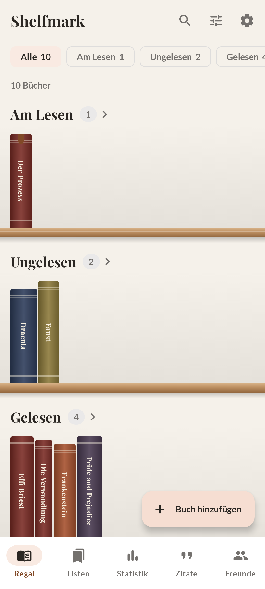

# Shelfmark

A personal library and reading tracker for Android. No account, no ads, no server: your books
stay on your phone. The interface is available in English and German.

This is the native Android version (Kotlin, Jetpack Compose) of the desktop Shelfmark. It can
import the desktop app's library file.

<p>
  
  
  
  
</p>

## What it does

**Adding books**

- Scan the ISBN barcode on the back of a book with the camera, several books in a row if you like.
- Search by title, author or ISBN. Suggestions appear while you type, which is what you want
  for old editions that have no barcode.
- Enter a book completely by hand when no catalogue knows it.
- Per book: title, author, pages, format (hardcover, paperback, e-book, audiobook), blurb,
  publisher, year, language, series, genres, tags and a cover you can photograph yourself.

**Organising**

- Built-in lists: Wishlist, Unread, Reading, Read, Abandoned. Moving a book between them keeps
  the start and finish dates up to date.
- As many lists of your own as you like.
- The shelf as book spines on wooden boards, as covers, or as a plain list. Books without a
  cover picture get a drawn cloth cover, so every book looks like a book.

**Reading**

- Star rating in half steps, a spice level from one to five chillies, a review with the dates
  you started and finished.
- Reading sessions with a timer, progress and an estimate of the time left.
- Quotes: photograph the page (text recognition runs on the phone), paste from the clipboard,
  or share selected text from an e-book reader straight into Shelfmark.
- Notes, goals (books, pages or minutes, once or repeating), statistics and reading streaks.

**Friends**

- Share your library as a small file through any messenger. You choose whether friends see
  only what you own, or also your reading status, lists, ratings and reviews.
- Per book: whether you own it, borrowed it, or do not have it, and whether friends may ask
  for it.
- A friend can ask to borrow a book that is available. You answer with one tap, yes or no.
  Saying yes marks your copy as lent to them.

## How sharing works

There is no server. Everything friends exchange is a small `.shelfmark.json` file that travels
through the messenger you already use:

1. You tap **Share my library** and send the file.
2. Your friend opens it with Shelfmark and can browse your shelf.
3. On a book that is available they tap **Ask to borrow**, which creates a request file to send
   back to you.
4. You open it, tap **Yes** or **No**, and send the answer file.

Share again whenever your shelf has changed. The friend's copy is replaced.

## Install

Build the APK (see below) or take one from the releases page, copy it to the phone and open it.
Android asks once whether it may install apps from that source.

If the older Shelfmark (the one built from the desktop version) is installed, export your
library there first, uninstall it, then install this one and import the export under
**Settings > Backup > Restore or import**. The two cannot be installed over each other unless
they are signed with the same key.

## Build

You need a JDK (17 or newer) and the Android SDK (platform 37.2, build-tools 37).

```sh
./gradlew assembleDebug        # app/build/outputs/apk/debug/app-debug.apk
./gradlew assembleRelease      # app/build/outputs/apk/release/app-release.apk
```

**Signing.** Put a `keystore.properties` next to `settings.gradle.kts`:

```properties
storeFile=/path/to/your.keystore
storePassword=...
keyAlias=...
keyPassword=...
```

Without it the release build is signed with the debug key so that it still installs. Keep the
keystore and this file private. They are listed in `.gitignore`. Android only installs an update
over an earlier version that was signed with the same key.

## Tests

```sh
./gradlew testDebugUnitTest
```

The suite covers the catalogue clients (against recorded responses), barcode decoding, the
sharing and borrow request flow between simulated phones, backup and import, statistics and
goals. It also drives the real screens (in German) and writes screenshots to
`app/build/outputs/roborazzi`.

- `SHELFMARK_LIVE=1 ./gradlew testDebugUnitTest --tests '*LiveCatalogueTest'` talks to the real
  Open Library and Google Books.
- Maven Central rate-limits the large Robolectric jars per IP address. If the download is
  refused, point that one test dependency at a mirror:
  `-Pshelfmark.robolectricMirror=https://maven-central.storage-download.googleapis.com/maven2/`

## Book data

- [Open Library](https://openlibrary.org), no key needed.
- Google Books. It often refuses requests without a key. A free API key of your own can be
  entered under **Settings > Book catalogues**.

## Not here yet

Things the desktop Shelfmark has that this version does not: the calendar and the monthly and
yearly recaps, milestones, the purchase log, shelf ornaments and lying stacks, custom themes
built from four colours, per-shelf sort order, the timer alarm, and import from Goodreads,
StoryGraph and CSV exports.

## Licences

Code: MIT, see [LICENSE](LICENSE). Fonts: Playfair Display and Lato under the SIL Open Font
License, see [licenses](licenses). Text recognition uses Google ML Kit, which is free to use but
not open source.
